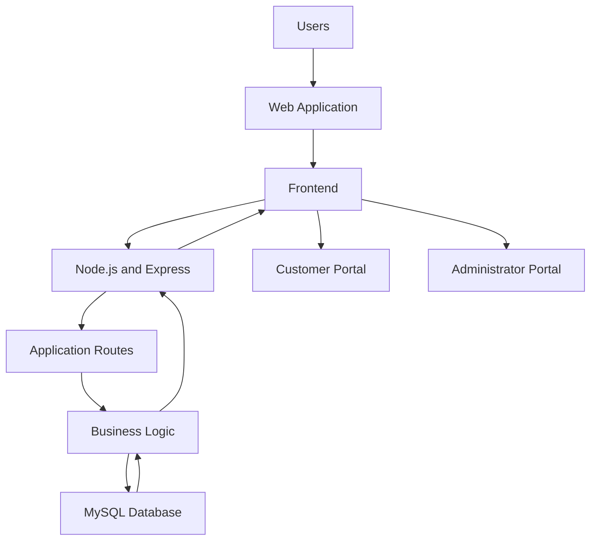
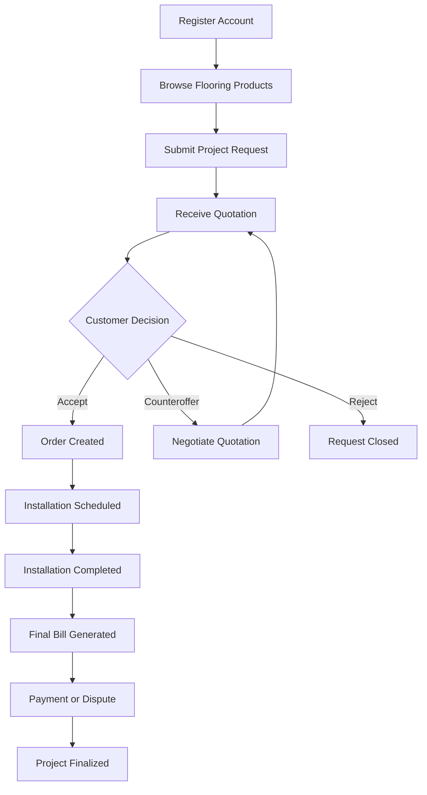
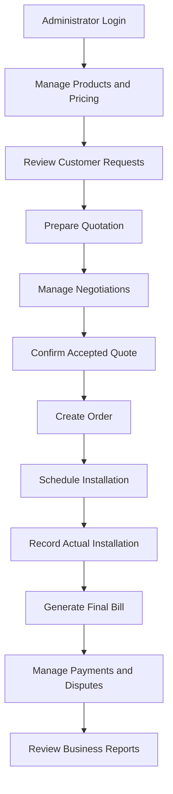

# Flooring Sales and Installation Management System

A web-based application for managing flooring sales, customer projects, product selection, quotations, installation services, billing, and business reporting.


**Course:** DSE 6100 – Database Management and Modeling  
**Project:** Project 2

---

<details>
<summary><strong>Table of Contents</strong></summary>

- Project Overview
- Website Preview
- System Architecture
- Features
- Customer and Administrator Workflows
- Technology Stack
- Project Structure
- Getting Started
- Database Setup
- Running the Application
- Using the Application
- Business Intelligence Dashboard
- Testing and Troubleshooting
- Development Progress
- Collaborators and Contributions
- Project Resources

</details>

---

<details>
<summary><strong>1. Project Overview</strong></summary>

The Flooring Sales and Installation Management System is designed to centralize the operations of a flooring sales and installation business.

The application supports two primary user groups:

**Customers** can register accounts, explore flooring products, submit installation requests, receive and negotiate quotations, track project progress, and manage final bills and payments.

**Administrator (Anna)** can manage customers and flooring products, review project requests, prepare quotations, coordinate installations, handle billing and payment disputes, and monitor business performance through a reporting dashboard.

The system maintains connected records throughout the customer journey, from initial registration to project completion and payment.

### Project Objectives

- Centralize customer and flooring product information.
- Simplify project requests and room measurements.
- Support quotation creation, negotiation, and approval.
- Track installation orders and project completion.
- Maintain billing, payment, and dispute histories.
- Provide business insights through database-driven reports.
- Implement a functional website connected to a relational MySQL database.

</details>

<details>
<summary><strong>2. Website Preview</strong></summary>

The following links represent the planned local application routes. They will become functional as the corresponding pages are developed.

| Website Section | Local Preview |
|---|---|
| Main Website | [Open Website](http://localhost:3000) |
| Customer Portal | [Open Customer Portal](http://localhost:3000/client) |
| Flooring Catalog | [View Flooring Catalog](http://localhost:3000/catalog) |
| Project Requests | [View Project Requests](http://localhost:3000/projects) |
| Quote Management | [View Quotes](http://localhost:3000/quotes) |
| Administrator Dashboard | [Open Admin Dashboard](http://localhost:3000/admin) |

**Note:** Start the application locally before opening these links. Routes will be implemented as development progresses.

</details>

<details>
<summary><strong>3. System Architecture</strong></summary>

The application follows a client-server architecture. The frontend communicates with the Express backend, which processes requests and interacts with the MySQL database.



### Application Layers

| Layer | Responsibility |
|---|---|
| Frontend | User interface, forms, navigation, and presentation |
| Backend | Application routes, validation, authentication, and business logic |
| Database | Persistent storage, relationships, and data integrity |
| Reporting | SQL queries and administrator dashboard results |

</details>

<details>
<summary><strong>4. Features</strong></summary>

### Customer Portal

**Account Management**
- Customer registration and unique customer identification.
- Secure login and session management.
- Customer contact and service address information.
- Registered payment method management.

**Flooring Catalog**
- Browse available flooring products.
- View product categories, brands, materials, colors, and styles.
- Review product dimensions, package coverage, and pricing information.

**Project Requests**
- Submit flooring installation requests.
- Add multiple rooms or project areas.
- Enter room dimensions or total square footage.
- Select desired flooring products.
- Specify existing flooring and removal requirements.
- Select installation patterns.
- Provide preferred installation dates, budget, notes, and up to five project photos.

**Quotations and Negotiations**
- Review proposed quotations.
- Accept, reject, or cancel quotations.
- Submit counterproposals.
- Review revised quotations.
- Maintain historical quote versions and responses.

**Installation and Billing**
- View accepted project and installation details.
- Track scheduled, in-progress, completed, and canceled projects.
- Review final bills.
- Submit payments or dispute billing amounts.
- View billing adjustments and payment history.

### Administrator Portal

**Customer and Product Management**
- View and manage customer records.
- Add and update flooring products.
- Maintain product categories, descriptions, and pricing.

**Project and Quote Management**
- Review submitted customer requests.
- Examine room measurements and project details.
- Prepare quotations and associated cost breakdowns.
- Review counterproposals and customer responses.
- Maintain quote history.

**Installation Management**
- Generate orders from accepted quotations.
- Coordinate installation schedules.
- Track actual installation dates and material usage.
- Record completion notes and project status.

**Billing Management**
- Generate final bills.
- Process and review payment records.
- Handle disputes, credits, and adjustments.
- Preserve billing history and responses.

**Business Dashboard**
- Access ten required business reports.
- Review sales, customer activity, material usage, and overdue payments.
- Analyze project and customer performance.

</details>

<details>
<summary><strong>5. Customer and Administrator Workflows</strong></summary>

### Customer Journey



### Administrator Workflow



</details>

<details>
<summary><strong>6. Technology Stack</strong></summary>

| Component | Technology | Purpose |
|---|---|---|
| Frontend | HTML | Application structure |
| Styling | CSS | Layout and visual design |
| Client-side scripting | JavaScript | Interactive functionality |
| Backend | Node.js | Server-side JavaScript runtime |
| Web framework | Express.js | Routing and application logic |
| Database | MySQL | Relational data storage |
| Database tools | MySQL Workbench / phpMyAdmin | Database administration |
| Database connection | mysql2 | Node.js and MySQL integration |
| File uploads | Multer | Project photo uploads |
| Authentication | bcrypt | Password hashing |
| Sessions | express-session | User session management |
| Version control | Git | Source code tracking |
| Collaboration | GitHub | Shared repository and project management |

</details>

<details>
<summary><strong>7. Project Structure</strong></summary>

The repository is organized to separate database scripts, application logic, frontend resources, documentation, and testing.

```text
DSE_6.1k_FlooringManagementSystem/
│
├── database/
│   ├── schema.sql
│   ├── sample_data.sql
│   └── .gitkeep
│
├── docs/
│   ├── er-diagram/
│   ├── screenshots/
│   └── .gitkeep
│
├── public/
│   ├── css/
│   ├── js/
│   ├── images/
│   └── .gitkeep
│
├── src/
│   ├── config/
│   ├── controllers/
│   ├── middleware/
│   ├── routes/
│   ├── services/
│   ├── utils/
│   └── .gitkeep
│
├── views/
│   ├── client/
│   ├── admin/
│   └── .gitkeep
│
├── uploads/
├── tests/
├── README.md
├── package.json
├── package-lock.json
├── .env.example
├── .gitignore
└── sql.txt
```

### Directory Guide

| Directory / File | Description |
|---|---|
| `database/` | Database creation scripts and sample records |
| `docs/` | ER diagrams, documentation, and screenshots |
| `public/` | Frontend stylesheets, JavaScript, and images |
| `src/config/` | Application and database configuration |
| `src/controllers/` | Request handling and application operations |
| `src/middleware/` | Authentication and request middleware |
| `src/routes/` | Application endpoints |
| `src/services/` | Reusable business logic |
| `src/utils/` | Helper functions |
| `views/client/` | Customer-facing pages |
| `views/admin/` | Administrator-facing pages |
| `uploads/` | Uploaded project photos |
| `tests/` | Application testing resources |
| `sql.txt` | Ten required business reporting queries |

*The structure may change as implementation develops.*

</details>

<details>
<summary><strong>8. Getting Started</strong></summary>

### Prerequisites

Before running the project, install:

| Software | Purpose | Download |
|---|---|---|
| Node.js and npm | Run the backend and install dependencies | [Node.js](https://nodejs.org/) |
| MySQL Server | Database engine | [MySQL](https://dev.mysql.com/downloads/) |
| Git | Clone and manage the repository | [Git](https://git-scm.com/) |
| MySQL Workbench or phpMyAdmin | Manage the database | [MySQL Workbench](https://dev.mysql.com/downloads/workbench/) |

Verify the installations:

```bash
node --version
npm --version
git --version
```

### Step 1: Clone the Repository

```bash
git clone https://github.com/rifahtas/DSE_6.1k_FlooringManagementSystem.git
cd DSE_6.1k_FlooringManagementSystem
```

Open the project in Visual Studio Code:

```bash
code .
```

### Step 2: Install Dependencies

```bash
npm install
```

This installs the packages listed in `package.json`.

### Step 3: Configure Environment Variables

Create a local `.env` file based on `.env.example`.

Example configuration:

```env
PORT=3000

DB_HOST=localhost
DB_USER=your_mysql_username
DB_PASSWORD=your_mysql_password
DB_NAME=flooring_management

SESSION_SECRET=replace_with_your_own_secret
```

Replace the example values with your own local configuration.

**Important:** Do not commit your `.env` file or share database passwords, session secrets, or other credentials. The `.env.example` file should contain placeholders only.

</details>

<details>
<summary><strong>9. Database Setup</strong></summary>

The application requires a MySQL database to store customer, product, project, quotation, order, installation, billing, and payment information.

### Step 1: Create the Database

Open MySQL Workbench or phpMyAdmin and execute:

```sql
CREATE DATABASE flooring_management;
USE flooring_management;
```

### Step 2: Create the Tables

Execute the database schema script:

```text
database/schema.sql
```

This script will define the tables, primary keys, foreign keys, constraints, and relationships.

### Step 3: Insert Sample Data

Execute:

```text
database/sample_data.sql
```

Sample records will be used to test application functionality and demonstrate the business reports.

*The actual database scripts and execution order will be finalized as development progresses.*

</details>

<details>
<summary><strong>10. Running the Application</strong></summary>

Once the database and application configuration are ready, start the server:

```bash
npm start
```

For development mode, a separate script may be provided:

```bash
npm run dev
```

Open your browser and visit:

| Website Section | Local URL |
|---|---|
| Main Website | http://localhost:3000 |
| Customer Portal | http://localhost:3000/client |
| Flooring Catalog | http://localhost:3000/catalog |
| Project Requests | http://localhost:3000/projects |
| Quote Management | http://localhost:3000/quotes |
| Administrator Dashboard | http://localhost:3000/admin |

The exact commands and routes will be updated to match the completed implementation.

</details>

<details>
<summary><strong>11. Using the Application</strong></summary>

### Customer Demonstration

The customer portal will allow users to experience the flooring purchase and installation process.

Example demonstration:

1. Register a new customer account.
2. Sign in to the customer portal.
3. Browse available flooring products.
4. Submit a project request.
5. Add room dimensions and project details.
6. Review the quotation provided by the administrator.
7. Accept the quotation or submit a counterproposal.
8. Review the installation schedule.
9. Track the project through completion.
10. Review the final bill and payment status.

**Test account credentials:** To be provided after authentication is implemented.

### Administrator Demonstration

The administrator portal will demonstrate the business management process.

Example demonstration:

1. Sign in using the administrator account.
2. Review customer registrations.
3. Add or update flooring products.
4. Review submitted project requests.
5. Prepare and send quotations.
6. Respond to customer negotiations.
7. Schedule accepted projects.
8. Update installation information.
9. Generate final bills.
10. Review payments, disputes, and business reports.

**Test account credentials:** To be provided after authentication is implemented.

</details>

<details>
<summary><strong>12. Business Intelligence Dashboard</strong></summary>

The administrator dashboard will include ten SQL-driven business reports.

| # | Report | Purpose |
|---|---|---|
| 01 | Best Customers | Identify customers with the highest total payments for completed projects. |
| 02 | Window Shoppers | Find customers with at least three requests who have never accepted a quote. |
| 03 | This Month's Flooring Sales | Display accepted quotations for a selected month and year. |
| 04 | Registered but Inactive | Identify registered customers who have never submitted a request. |
| 05 | Largest Flooring Project | Find completed projects with the greatest installed square footage, including ties. |
| 06 | Most Popular Flooring Materials | Rank products by actual installed square footage. |
| 07 | Material Cost Analysis | Identify completed projects where actual material usage exceeds the original estimate by at least 10%. |
| 08 | Overdue Bills | Find unpaid bills outstanding for more than seven days. |
| 09 | Problem Customers | Identify customers with at least two overdue bills who have never paid an overdue bill within seven days of becoming overdue. |
| 10 | Excellent Customers | Identify customers who have consistently paid every bill within 24 hours of bill generation. |

The SQL statements will be maintained separately in `sql.txt`, with each query labeled by its report number.

The dashboard will display the results through the website rather than requiring users to execute SQL manually.

</details>

<details>
<summary><strong>13. Testing and Troubleshooting</strong></summary>

### Common Issues and Solutions

| Issue | Possible Solution |
|---|---|
| `node: command not found` | Install Node.js and reopen Terminal. |
| `npm install` fails | Check Node.js version and network connectivity. |
| Database connection error | Verify MySQL is running and `.env` credentials are correct. |
| Unknown database | Create the database and verify its configured name. |
| Table does not exist | Execute the database schema script. |
| Port already in use | Stop the other application using the port or change the configured port. |
| `Cannot find module` | Run `npm install` and check the dependency configuration. |
| Page not found | Confirm the application route exists and the server is running. |
| Login does not work | Check the account credentials and authentication configuration. |

### Development and Testing Notes

- Use sample records to test customer and administrator workflows.
- Verify that invalid inputs are handled appropriately.
- Check primary key and foreign key relationships.
- Test quote revisions and negotiation history.
- Verify installation and billing status changes.
- Confirm that dashboard reports update when website data changes.
- Avoid using real payment card information in development.

</details>

<details>
<summary><strong>14. Development Progress</strong></summary>

| Development Component | Status |
|---|---|
| GitHub repository | Completed |
| Initial folder structure | Completed |
| Requirements analysis | Pending |
| ER diagram | Pending |
| Relational schema | Pending |
| MySQL database implementation | Pending |
| Backend development | Pending |
| Frontend development | Pending |
| Customer portal | Pending |
| Administrator portal | Pending |
| Business reporting dashboard | Pending |
| Testing and debugging | Pending |
| Final documentation | Pending |

</details>

<details>
<summary><strong>15. Collaborators and Contributions</strong></summary>

This project is developed collaboratively using Git and GitHub.

| Collaborator | GitHub Profile |
|---|---|
| Rifah Tasniya | [@rifahtas](https://github.com/rifahtas) |
| Most. Afroz | [@most-afroz](https://github.com/most-afroz) |

### GitHub Collaboration

The shared repository is used to manage source code and coordinate development.

- **Commits:** Track code changes and their authors.
- **Branches:** Support separate feature development.
- **Pull Requests:** Review and merge code changes.
- **Repository History:** Follow project development over time.

### Explore Contributions

- [GitHub Contributors](https://github.com/rifahtas/DSE_6.1k_FlooringManagementSystem/graphs/contributors)
- [Commit History](https://github.com/rifahtas/DSE_6.1k_FlooringManagementSystem/commits/main/)
- [Shared Repository](https://github.com/rifahtas/DSE_6.1k_FlooringManagementSystem)

GitHub automatically attributes commits to the associated accounts when contributors use their own Git identities.

</details>

<details>
<summary><strong>16. Project Resources</strong></summary>

| Resource | Location |
|---|---|
| Source Code | [GitHub Repository](https://github.com/rifahtas/DSE_6.1k_FlooringManagementSystem) |
| ER Diagram | `docs/er-diagram/` |
| Database Scripts | `database/` |
| Dashboard SQL Queries | `sql.txt` |
| Screenshots | `docs/screenshots/` |
| Project PDF | To be added |
| Demonstration Video | To be added |

</details>

---

**DSE 6100 – Database Management and Modeling | Project 2**

**Flooring Sales and Installation Management System**  
**Project Status:** In Development