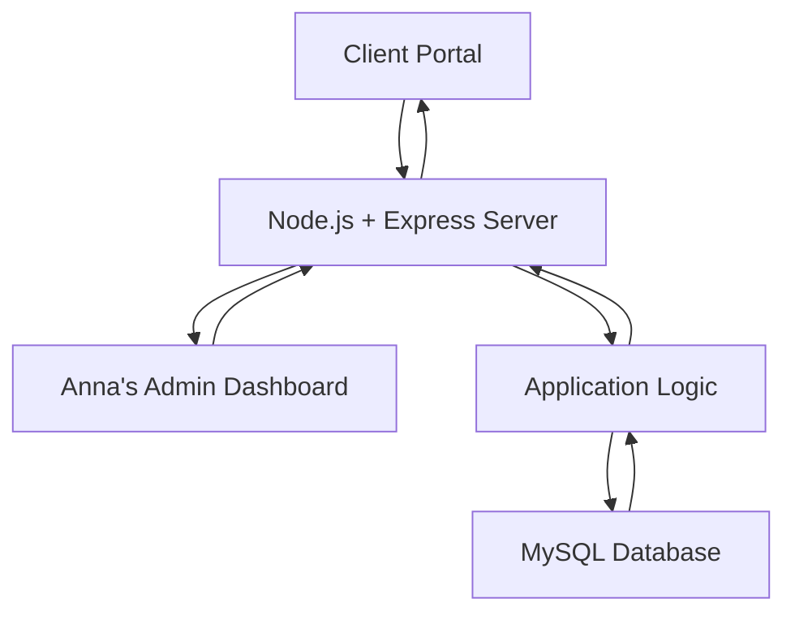
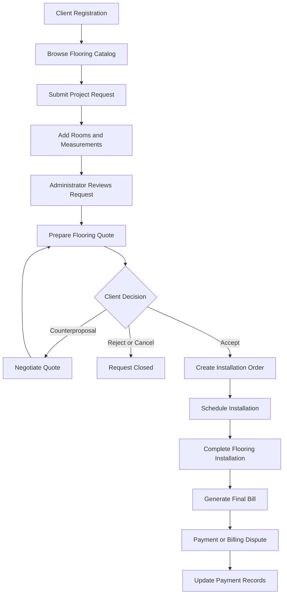

# Flooring Sales and Installation Management System


A web-based flooring sales and installation management system developed to manage customers, flooring products, project requests, estimates, negotiations, installation orders, billing, and business reporting.

---

## Table of Contents

- [Project Overview](#project-overview)
- [System Architecture](#system-architecture)
- [Features](#features)
- [System Workflow](#system-workflow)
- [Technology Stack](#technology-stack)
- [Project Structure](#project-structure)
- [Database Design](#database-design)
- [Anna's Business Dashboard](#annas-business-dashboard)
- [Installation and Setup](#installation-and-setup)
- [Testing](#testing)
- [Collaboration and Git Workflow](#collaboration-and-git-workflow)
- [Contributors](#contributors)
- [Project Status](#project-status)

---

## Project Overview

The Flooring Sales and Installation Management System is designed for a flooring sales and installation business.

The application provides two primary interfaces:

- **Client Portal:** Allows customers to register, browse flooring products, submit project requests, receive and negotiate quotes, accept proposals, track installation orders, and manage invoices and payments.
- **Administrative Dashboard:** Allows the business administrator, Anna, to manage flooring products, customers, project requests, estimates, installation orders, billing, and business analytics.

The system uses a relational MySQL database to maintain customer, product, project, quote, order, and billing information while preserving important transaction and negotiation history.

## System Architecture

The application follows a three-tier architecture:



**Architecture overview:**

| Layer | Technology | Responsibility |
|---|---|---|
| Frontend | HTML, CSS, JavaScript | User interfaces and interactions |
| Backend | Node.js, Express.js | Routes, application logic, and business rules |
| Database | MySQL | Persistent storage and relational data management |
| Development tools | VS Code, MySQL Workbench/phpMyAdmin, Git | Development, database management, and version control |

## Features

The following features represent the planned application functionality.

| # | Feature | Description |
|---|---|---|
| 1 | Client Registration | Register customers and assign unique client IDs |
| 2 | Client Profiles | Maintain customer contact and service information |
| 3 | Flooring Catalog | Browse available flooring products, styles, brands, and prices |
| 4 | Product Management | Allow Anna to add, update, and manage flooring products |
| 5 | Project Requests | Submit flooring installation requests for one or multiple rooms |
| 6 | Room Measurements | Record room dimensions and calculate total flooring area |
| 7 | Project Photographs | Upload room and existing-floor photographs |
| 8 | Quote Management | Prepare estimates for materials, labor, removal, and additional services |
| 9 | Quote Negotiations | Support acceptance, rejection, cancellation, and counterproposals |
| 10 | Installation Orders | Generate orders from accepted quotes and manage installation schedules |
| 11 | Installation Tracking | Record installation progress, actual quantities, and completion details |
| 12 | Billing and Payments | Generate final bills, record payments, and manage disputes |
| 13 | Administrative Dashboard | Provide business reporting and customer analytics |

## System Workflow



## Technology Stack

| Technology | Intended Use |
|---|---|
| Node.js | JavaScript runtime |
| Express.js | Backend web framework |
| MySQL | Relational database |
| mysql2 | MySQL connectivity from Node.js |
| HTML5 | Page structure |
| CSS3 | Website styling |
| JavaScript | Frontend interactions and backend development |
| Git | Version control |
| GitHub | Collaboration and source-code hosting |
| VS Code | Development environment |

Additional packages will be documented once they are selected and implemented.

## Project Structure

```text
DSE_6.1k_FlooringManagementSystem/
│
├── database/
│   ├── .gitkeep
│   ├── schema.sql
│   ├── sample_data.sql
│   └── queries/
│
├── docs/
│   ├── er-diagram/
│   └── screenshots/
│
├── public/
│   ├── css/
│   ├── js/
│   └── images/
│
├── src/
│   ├── config/
│   ├── controllers/
│   ├── middleware/
│   ├── routes/
│   ├── services/
│   └── utils/
│
├── views/
│   ├── admin/
│   └── client/
│
├── uploads/
├── tests/
├── .env.example
├── .gitignore
├── package.json
├── package-lock.json
├── README.md
└── server.js
```

*The structure will be updated as files and application components are implemented.*

## Database Design

The database will use a relational structure to maintain data integrity and relationships between the main business entities.

Planned entity groups include:

- Clients
- Flooring Products
- Project Requests
- Project Rooms and Measurements
- Quotes and Quote Line Items
- Quote Negotiations and Responses
- Installation Orders
- Installation Records
- Bills and Bill Revisions
- Payments and Payment Records

The database design will include primary keys, foreign keys, appropriate constraints, and relationships to preserve transaction history.

The finalized ER diagram and relational schema will be included in the project documentation.

## Anna's Business Dashboard

The administrative dashboard will provide access to ten business queries:

| # | Dashboard Query | Purpose |
|---|---|---|
| 1 | Best Customers | Identify customers with the highest total payments for completed projects |
| 2 | Window Shoppers | Identify customers with at least three requests but no accepted quote |
| 3 | This Month's Flooring Sales | Review quotes accepted during a selected month |
| 4 | Registered but Inactive | Find registered customers who have never submitted a request |
| 5 | Largest Flooring Project | Identify the largest completed project by installed square footage |
| 6 | Most Popular Flooring Materials | Rank products by actual installed square footage |
| 7 | Material Cost Analysis | Identify projects where actual material use exceeded estimates by at least 10% |
| 8 | Overdue Bills | Find unpaid bills outstanding for more than seven days |
| 9 | Problem Customers | Identify customers meeting the overdue-bill criteria |
| 10 | Excellent Customers | Identify customers who consistently paid within 24 hours of billing |

The dashboard will display query results through the website and allow Anna to review business performance.

## Installation and Setup

> **Development setup is in progress.** The following instructions will be finalized after the application, database, and environment configuration have been implemented and tested.

### Requirements

- Node.js and npm
- MySQL Server
- VS Code or another code editor
- Git

### Clone the Repository

```bash
git clone https://github.com/rifahtas/DSE_6.1k_FlooringManagementSystem.git
cd DSE_6.1k_FlooringManagementSystem
```

### Install Dependencies

```bash
npm install
```

### Database Configuration

Database creation, initialization, sample data, and connection settings will be documented after implementation.

### Start the Application

The application startup command and local website address will be added after the server is configured and tested.

## Testing

Testing will cover:

- Client registration and account information
- Flooring product management
- Project requests and room measurements
- Quote calculations and negotiation history
- Installation order creation and completion
- Bill generation, payment, and disputes
- Administrative dashboard query results
- Database relationships and data integrity

## Collaboration and Git Workflow

This project is being developed collaboratively by two partners.

Each partner will contribute through GitHub using individual commits and shared project updates.

### Common Git Commands

| Command | Purpose |
|---|---|
| `git clone` | Download the repository |
| `git status` | Check modified and untracked files |
| `git pull` | Retrieve the latest repository changes |
| `git add` | Stage changes |
| `git commit` | Save a local contribution |
| `git push` | Upload commits to GitHub |

### Collaboration Guidelines

1. Pull the latest changes before starting new work.
2. Work on assigned features and use descriptive commits.
3. Avoid editing the same files simultaneously without coordinating.
4. Review changes before merging or integrating contributions.
5. Document individual responsibilities and approximate collaborative hours.

A detailed contribution breakdown will be added as development progresses.

## Contributors

- [@rifahtas](https://github.com/rifahtas)
- [@most-afroz](https://github.com/most-afroz)

## Project Status

<text>**Current phase:** Repository setup and project planning.</text>

The application, database, diagrams, testing, and documentation will be developed incrementally.

---

**Course Project:** DSE 6.1K  
**Project:** Project 2 – Flooring Sales and Installation Management System